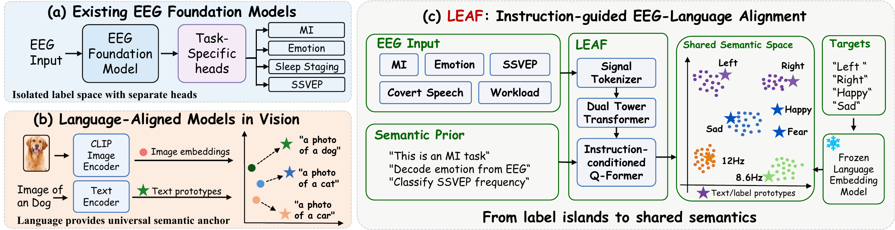
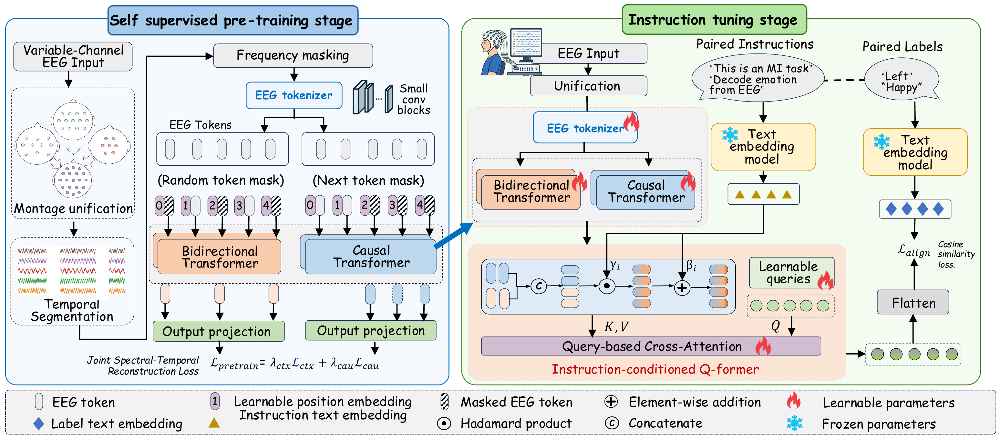
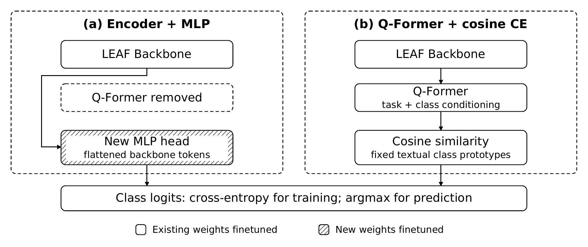

# Language-EEG Aligned Foundation Model for Brain-Computer Interfaces (NeurIPS 2026)

[Project page](https://leaf-bci.github.io/) · [Paper](https://arxiv.org/abs/2509.24302) · [Documentation](https://leaf-bci.github.io/docs/) · [Checkpoints](https://github.com/Jiang-Muyun/LEAF/releases)

**LEAF** aligns EEG representations with natural-language task instructions and label descriptions. It combines self-supervised EEG pretraining with instruction tuning. The resulting checkpoint supports direct classification using text prototypes, embedding extraction, and supervised adaptation to a target dataset.

<p align="center">
  
</p>

| What you want to do | Start here |
| --- | --- |
| Evaluate the released model on supported datasets | [Quick start](#quick-start) |
| Pretrain the EEG encoder or run instruction tuning | [Pretraining and instruction tuning](#pretraining-and-instruction-tuning) |
| Adapt the model using labeled target data | [Supervised fine-tuning](#supervised-fine-tuning) |
| Extract embeddings and classify your own EEG trials | [Apply LEAF to a new EEG dataset](#apply-leaf-to-a-new-eeg-dataset) |

## Quick start

Run all commands from the repository root, which contains `LEAF.py`. This section evaluates the released instruction-tuned model without updating its parameters.

### 1. Prepare the data

Set the dataset paths in [`configs/env.yaml`](configs/env.yaml). Use the preprocessing scripts in [`leaf_datasets/`](leaf_datasets/) to prepare the downstream HDF5 datasets under `paths.downstream`; see the [dataset documentation](https://leaf-bci.github.io/docs/datasets/) for preparation and split details. Direct inference needs the processed downstream data, not the pretraining corpus.

The commands below use [`configs/LEAF_mpnet.yaml`](configs/LEAF_mpnet.yaml) and the MPNet text embeddings in [`text_embeddings/`](text_embeddings/). Dataset names, class-label order, and task instructions are defined in [`configs/tasks.yaml`](configs/tasks.yaml).

### 2. Download the checkpoint

```bash
wget -c -P checkpoints https://github.com/Jiang-Muyun/LEAF/releases/download/v1.0/leaf-v1.0-instruct-mpnet-base.ckpt
```

To download both the pretrained EEG Tower and instruction-tuned model, run `bash download_checkpoints.sh`.

### 3. Run direct inference

Start with one prepared dataset:

```bash
python c_direct_inference.py \
  --config configs/LEAF_mpnet.yaml \
  --ckpt leaf-v1.0-instruct-mpnet-base.ckpt \
  --ds MI_BCIC_IV2a --gpu 0 --bs 256 --level 0,1,2
```

Omit `--ds` to evaluate all datasets registered in `configs/tasks.yaml`, or pass a comma-separated list such as `--ds MI_BCIC_IV2a,MI_OpenBMI`.

| Instruction level | Model input |
| --- | --- |
| `0` | Default instruction |
| `1` | Task-specific instruction |
| `2` | Task instruction combined with the mean of candidate-label embeddings |

All three levels run by default. Use `--level 2` to evaluate only task-and-class conditioning. `--gpu` accepts one GPU index or `-1` for CPU. `--seed` controls instruction selection; the selected texts remain the same when evaluating a subset of datasets or levels.

Results are written beside the checkpoint:

```text
direct_inference/<checkpoint-stem>_per_dataset.csv
direct_inference/<checkpoint-stem>_per_dataset.json
```

The CSV contains balanced accuracy and Cohen's kappa for each dataset and level, plus an equal-weight `MEAN` row. The JSON records the configuration, class order, selected instructions, and progress. Results are saved after each dataset. Use `--output path/to/results.csv` to choose a new destination; existing results are not overwritten. See the [direct inference documentation](https://leaf-bci.github.io/docs/direct-inference.html) for more details.

## Pretraining and instruction tuning

LEAF training has two stages: self-supervised learning of the EEG Tower, followed by alignment with task instructions and label-text prototypes.

<p align="center">
  
</p>

### 1. Pretrain the EEG Tower

Prepare the unlabeled `.npy` corpus and set `paths.pretrain` in `configs/env.yaml`, then run:

```bash
python a_pretrain.py --config configs/LEAF_mpnet.yaml --bs 256 --gpu 0,1
```

### 2. Align EEG with language

Instruction tuning uses the labeled downstream datasets and cached text embeddings. To start from the released pretrained Tower:

```bash
wget -c -P checkpoints https://github.com/Jiang-Muyun/LEAF/releases/download/v1.0/leaf-v1.0-pretrain.ckpt

python b_instruct_tuning.py \
  --config configs/LEAF_mpnet.yaml \
  --pretrain_ckpt leaf-v1.0-pretrain.ckpt \
  --bs 256 --gpu 0,1 --seed 0
```

Use `--pretrain_ckpt` to select your own pretrained Tower checkpoint instead. Training settings are configured in the `pretrain` and `instruct` sections of the YAML file. See the [pretraining](https://leaf-bci.github.io/docs/pretraining.html) and [instruction tuning](https://leaf-bci.github.io/docs/instruction-tuning.html) documentation for the full protocols.

## Supervised fine-tuning

Both paths below initialize from the **same instruction-tuned LEAF checkpoint** and adapt to labeled training data from one target dataset.

<p align="center">
  
</p>

### A. EEG encoder + MLP

[`d_downstream_add_mlp.py`](d_downstream_add_mlp.py) restores the EEG Tower, removes the Q-Former from the classification path, and adds a randomly initialized dataset-specific MLP. The MLP classifies the flattened, concatenated contextual and causal branch tokens. The encoder and MLP are jointly optimized with cross-entropy; prediction uses the largest classifier logit. This is the setting used in the paper's main supervised comparisons.

```bash
python d_downstream_add_mlp.py \
  --config configs/LEAF_mpnet.yaml \
  --ckpt leaf-v1.0-instruct-mpnet-base.ckpt \
  --ds MI_BCIC_IV2a --gpu 0 --bs 128 --epochs 100 --seed 0
```

### B. EEG encoder + Q-Former

[`d_downstream_qformer_ce.py`](d_downstream_qformer_ce.py) restores the full LEAF model and jointly fine-tunes the existing encoder and Q-Former. Cross-entropy is applied directly to cosine similarities between normalized EEG embeddings and fixed label-text prototypes. **No new trainable parameters are added.**

The instruction combines the task description with the normalized mean of the candidate-label prototypes. It uses the candidate class set, not the individual trial's ground-truth label. Prediction selects the class with the largest cosine similarity.

```bash
python d_downstream_qformer_ce.py \
  --config configs/LEAF_mpnet.yaml \
  --ckpt leaf-v1.0-instruct-mpnet-base.ckpt \
  --ds MI_BCIC_IV2a --gpu 0 --bs 128 --epochs 100 --seed 0
```

### Shared training and evaluation settings

Both scripts use the dataset-specific partitions in [`load_datasets.py`](load_datasets.py). Labels must follow the class order in `configs/tasks.yaml`; the Q-Former path also requires the matching cached text embeddings.

The commands explicitly set the paper's 100-epoch, batch-size-128 settings. These override the MLP script's default batch size of 512 and the Q-Former script's configured epoch count of 200. With `configs/LEAF_mpnet.yaml`, both use AdamW, weight decay `1e-3`, one warmup epoch, and cosine decay to 0.1 times the peak learning rate. Peak rates are `1e-3` for the tokenizer and MLP, when present, and `1e-4` for the remaining parameters. GPU training defaults to bf16 mixed precision; `--gpu -1` uses CPU fp32.

The best checkpoint is selected by validation balanced accuracy, with validation loss breaking ties. The test set is evaluated once after selection. Each run saves `best.ckpt`, `run.json`, and `metrics.npz` under `mlp_finetuning/` or `qformer_finetuning/` beside the source checkpoint; the Q-Former path also saves `text_readout.npz`. Use `--outdir` for a new destination and `--seed` for another run. Existing output directories are not overwritten.

For additional details, see the [fine-tuning documentation](https://leaf-bci.github.io/docs/single-dataset-finetuning.html).

## Apply LEAF to a new EEG dataset

The following example uses the released instruction-tuned model on custom EEG trials, without additional training. Run the Python blocks in order in the same session from the repository root.

Assume the input contains 4-second trials recorded from 32 channels at 250 Hz, shaped `(N, 32, 1000)`. Replace the random input with your own epoched data and adjust the channel names, task instruction, and candidate labels.

### 1. Preprocess and align the channels

```python
import mne
import numpy as np

from leaf_datasets.shared import pipeline

channels = [
    'Fp1', 'Fp2', 'F7', 'F3', 'Fz', 'F4', 'F8', 'FC5',
    'FC1', 'FC2', 'FC6', 'T7', 'C3', 'Cz', 'C4', 'T8',
    'CP5', 'CP1', 'CP2', 'CP6', 'P7', 'P3', 'Pz', 'P4',
    'P8', 'POz', 'O1', 'Oz', 'O2', 'AF3', 'AF4', 'FCz',
]

# Replace this random array with your epoched EEG data.
raw_eeg = np.random.randn(2, 32, 1000).astype(np.float32)

info = mne.create_info(channels, sfreq=250, ch_types='eeg')
epochs = mne.EpochsArray(raw_eeg, info, verbose=False)
epochs.filter(l_freq=0.1, h_freq=70, method='iir', verbose=False)
epochs.resample(200, verbose=False)

eeg = pipeline(epochs.get_data().astype(np.float32), channels)
print(eeg.shape)  # (2, 65, 800)
```

`pipeline` clips extreme values, applies robust scaling with the median and interquartile range, maps the supplied channel names to the LEAF 65-channel montage, and interpolates missing template channels. Channel names must match an electrode or alias in `configs/LEAF-ch65/LEAF-ch65.json`; add an alias there if a dataset uses a different name.

After preprocessing, each trial has shape `(65, 800)` at 200 Hz. With the default configuration, LEAF uses 100-sample windows and accepts inputs up to 2,000 samples (10 seconds). This example needs no padding to 10 seconds; its eight windows produce eight tokens per encoder branch. Crop or segment longer recordings before inference.

### 2. Extract EEG embeddings

```python
import torch

from LEAF import LEAF
from init_text_embeddings import load_embeddings
from load_config import build_model_config, load_yaml

device = torch.device('cuda' if torch.cuda.is_available() else 'cpu')
config = build_model_config(load_yaml('configs/LEAF_mpnet.yaml'))

model = LEAF(config)
state = torch.load(
    'checkpoints/leaf-v1.0-instruct-mpnet-base.ckpt',
    map_location='cpu',
    weights_only=True,
)
model.load_state_dict(state, strict=True)
model.to(device).eval()

text_embeddings = load_embeddings(config.text_emb_model_name)
instruction = torch.tensor(
    text_embeddings['This is an emotion recognition task'],
    dtype=torch.float32,
    device=device,
)

x = torch.tensor(eeg, dtype=torch.float32, device=device)
instruction = instruction.unsqueeze(0).expand(x.shape[0], -1)

with torch.inference_mode():
    eeg_embeddings, _ = model(x, instruction)

print(eeg_embeddings.shape)  # (2, 768) with MPNet
```

### 3. Predict with label text

The EEG embeddings and cached text prototypes are L2-normalized, so their dot product is cosine similarity. The following example compares every EEG trial with `Happy` and `Sad`:

```python
labels = ['Happy', 'Sad']
prototypes = torch.tensor(
    np.stack([text_embeddings[label] for label in labels]),
    dtype=torch.float32,
    device=device,
)

similarities = eeg_embeddings @ prototypes.T
distances = 1 - similarities
predictions = [labels[index] for index in similarities.argmax(dim=1).tolist()]

print(similarities.shape)  # (2, 2)
print(distances.shape)     # (2, 2)
print(predictions)
```

Replace the instruction and labels with the task of interest. If new text is not already cached, add it to `configs/tasks.yaml` and run `python init_text_embeddings.py mpnet-base` before inference.

## Citation

```bibtex
@article{jiang2026leaf,
  title={LEAF: Language-EEG Aligned Foundation Model for Brain-Computer Interfaces},
  author={Jiang, Muyun and Zhang, Shuailei and Yang, Zhenjie and Wu, Mengjun and Jiang, Weibang and Liu, Chenyu and Guo, Zhiwei and Zhang, Wei and Liu, Rui and Zhang, Shangen and Li, Yong and Ding, Yi and Guan, Cuntai},
  journal={arXiv preprint arXiv:2509.24302},
  year={2026}
}
```
